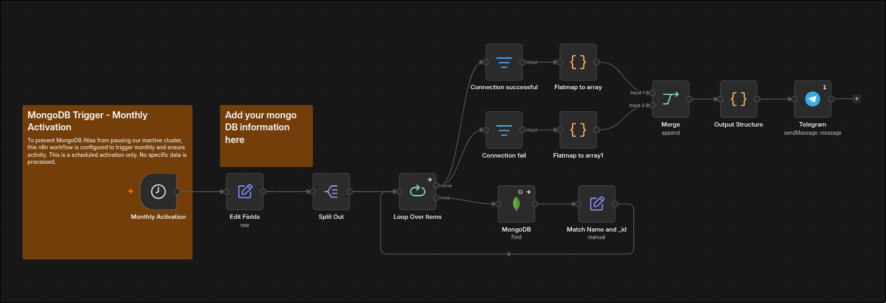
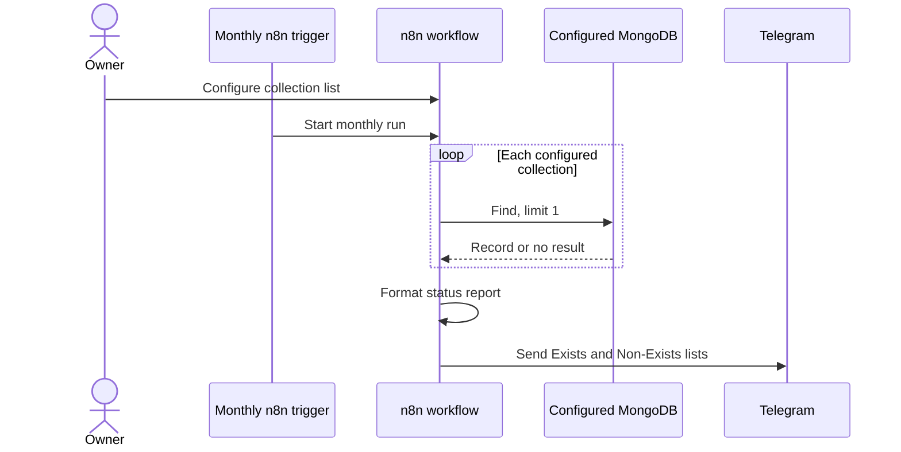
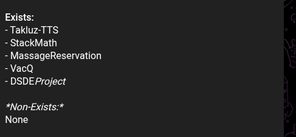

# MongoDB Monthly Activation

**A lightweight MongoDB heartbeat with a Telegram report.**

  
  
  

## What it is

A local n8n workflow scheduled to run monthly. It queries configured MongoDB collections with a small `find` request, then sends a Telegram report showing which queries returned a record. The heartbeat is intended to create recurring activity for older Atlas projects that may pause after a period of inactivity.

## Why I built it

Some of my older projects use MongoDB Atlas clusters that can pause when they receive no activity. I wanted a simple monthly automation to send a lightweight query and tell me whether each configured collection still returns a record. It is a small workflow with a practical purpose: keep legacy projects from quietly going idle and make their status visible in Telegram.

## How it works

The query reads at most one document from each configured collection. The report includes project labels and whether a document with an `_id` was returned; it does not send the document contents to Telegram.

## Example report

## Tech stack

- **Automation:** n8n running on a local host
- **Database:** MongoDB Atlas
- **Notifications:** Telegram Bot API

## Import the workflow

The sanitized workflow export is [`workflow/monthly-activation.json`](workflow/monthly-activation.json). There is no hosted demo because it runs in a local n8n instance and depends on connected accounts.

1. Import the JSON into n8n.
2. Set the project label and collection name in the `mongodbList` field.
3. Connect a MongoDB credential and choose a database that contains the configured collection.
4. Set your Telegram bot credential and replace `YOUR_TELEGRAM_CHAT_ID`.
5. Review the monthly schedule, run a manual test, then activate the workflow.

The export contains no connection strings, database passwords, chat ID, saved credentials, or instance metadata. It uses one MongoDB credential for the MongoDB node. To monitor clusters that use different credentials, configure a separate query path for each cluster; the workflow does not switch MongoDB connections dynamically from a per item URI.

## Design choices and limits

- **Read only heartbeat:** the MongoDB node uses `find` with a limit of one and does not insert or modify records.
- **A useful report, not a full health check:** the workflow classifies results by whether an `_id` is present. A missing result is not enough to distinguish an empty collection from every possible connection failure.
- **One configured connection:** the MongoDB node uses its configured credential for the query. Per item connection strings in the original export were not wired into the node, so they are omitted from this reusable template.
- **Monthly cadence:** this is the configured schedule, not a guarantee against every provider's inactivity policy. Adjust the frequency to fit the current limits of your MongoDB plan.

Review MongoDB Atlas, n8n, and Telegram requirements and costs before activating the workflow.
